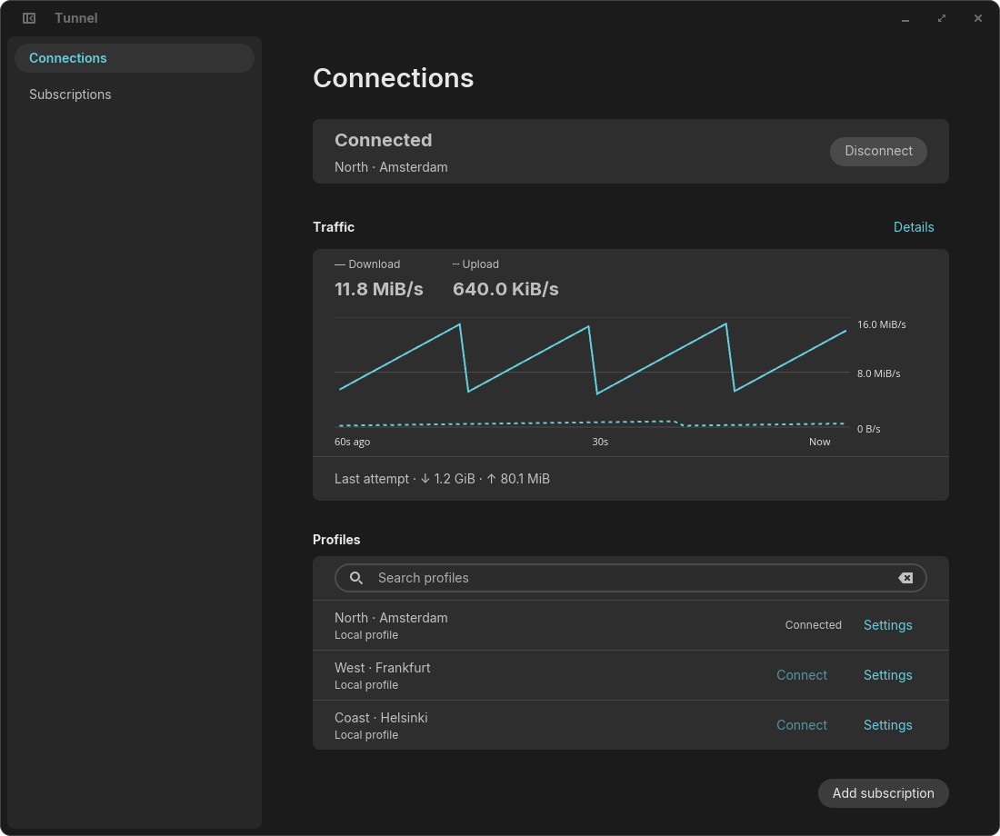

# NetworkManager Tunnel

NetworkManager Tunnel is a Linux VPN application that brings VLESS connections
into NetworkManager, with a native COSMIC interface for importing subscriptions,
connecting saved profiles and viewing traffic.

It is for users who want proxy-based VPN connections managed alongside their other
network connections, rather than by a separate proxy daemon or a mandatory tray app.
NetworkManager stores profiles and controls activation, routes and DNS. The desktop
app can close without disconnecting the VPN. The native interface follows the
system theme and language, with English and Russian translations.

**Experimental: the COSMIC app and VPN backend are implemented, but there is no
supported stable release yet.** KDE and GTK frontends are planned, not implemented.
This is an independent project, not an official NetworkManager or COSMIC component.



*The native COSMIC app with synthetic profiles and traffic, not a live VPN session
or a performance measurement. Production appearance follows the desktop theme.*

## What you can do now

- Import the checked native IPv4 subset of complete HTTPS subscriptions, preserving
  supported DNS/FakeIP, ordered routing and XUDP. Unsupported policy rejects atomically.
- Explicitly select legacy node-only import for plain/base64 VLESS URI lists.
  Search nodes and add individual profiles, without the provider's DNS/routing rules.
- Connect and disconnect saved profiles without loading the subscription again.
  Connections are explicit; importing never connects and autoconnect is off.
- Edit saved names and supported network settings without reconnecting; explicitly
  confirm deletion, awaiting NM disconnection first for an active target.
- Manage multiple subscriptions and review mapped updates. Source names/URLs and
  NM UUID associations persist through desktop Secret Service; unavailable storage
  is explicitly session-only, without a plaintext fallback. Isolated provider tests
  pass; real desktop unlock/prompt acceptance remains pending.
- View upload/download rates, totals, a 60-second traffic graph and backend diagnostics.
- Review optional provider-reported usage, quota, expiry and name/refresh hints,
  separately from local counters. Explicit subscription updates support bounded
  memory-only HTTP validators; hints never schedule updates or reconnect the VPN.
- Save profiles and credentials to disk in NetworkManager so they survive restart,
  with autoconnect off.
- Select DNS for a newly added profile: source/default policy, the current network's
  plain IPv4 DNS outside VPN, or one explicit public IPv4 resolver through VPN.
- Explicitly keep all RFC1918 IPv4 networks outside VPN, including routed LANs,
  while retaining the selected DNS interception policy. Old connected-only profiles
  keep their narrower mode until explicitly changed.

The backend uses Rust protocol libraries, not an external sing-box or Xray process.
The supported configuration model covers VLESS over TCP with TLS or REALITY,
optional Vision, and WebSocket over verified TLS without Vision. Configuration
support is not a guarantee of compatibility with every server.

## Current limits

- The [security review](docs/security-review.md) found two Medium issues in teardown
  ordering and fixed-name TUN creation. Both have source fixes and local regression
  evidence, not deployed security acceptance. Production use is not approved;
  independent review and broader packet/deployment checks remain required.
- The experimental tunnel carries IPv4 TCP/UDP; IPv6 is blocked. Legacy default DNS
  is `1.1.1.1`, with explicit profile overrides. Only the checked complete-source
  policy subset is supported, not arbitrary DNS/routing configurations or live
  endpoint/uplink changes. Override forwarding has not passed full NM/VM acceptance.
  The first version is explicitly IPv4-only: IPv6 literal endpoints cannot be added,
  and hostname endpoints require an A record. IPv6 support is deferred, not a
  prerequisite for the first joint test; see
  [ADR 0017](docs/decisions/0017-ipv4-only-first-version.md).
- Live REALITY compatibility and long-running reliability remain unresolved.
  Local runtime checks do not establish production security or interoperability.
- Terminal failure now ends the VPN session and automatically removes its guards,
  restoring ordinary networking **without VPN**. Independent systemd-owned orphan
  recovery, a process-pinned liveness watchdog and independent UI progress are
  implemented. D-Bus ProcessFD support is required. Synthetic legacy IPv4 VM checks
  passed real TUN TCP echo and crash/hang cleanup; broader packet and failure
  coverage remains pending; see
  [the recovery contract](docs/decisions/0026-automatic-session-recovery.md).
- Saved edits and explicitly mapped source updates require NM 1.44+ and keep the
  running VPN unchanged. Inactive save/edit/update/delete passed a bounded real-NM
  VM check; active-session edits and desktop Polkit prompts remain unaccepted;
  see [ADR 0027](docs/decisions/0027-cosmic-profile-and-source-management.md).
- There is no manual protocol editor, automatic subscription refresh, YAML subscription
  support or desktop secret-agent implementation.
- Complete subscription format is requested by default, but unsupported DNS/routing
  blocks import without a node-only fallback. Experimental TCP hostname rules exist
  in backend schema v2 alongside DNS overrides. Bounded complete IPv4 execution is
  implemented experimentally; see
  [the exact contract](docs/decisions/0020-native-ipv4-source-policy.md).
  Connected RFC1918
  LAN bypass is narrower than subscription private-IP rules and is not a substitute.
  A default-off backend TUN port-53 DNS interceptor exists, but is not full source
  DNS-hijack compatibility. Creation/replacement offers explicit DNS-interception
  and experimental persistent IPv4 FakeIP opt-ins. Combined LAN/DNS
  mode uses bounded direct TCP/UDP relays, not a physical LAN exception; other
  LAN IP protocols are unsupported in that mode. Full native acceptance remains pending.
  Complete IPv4 import and persistent FakeIP exist, but native/boot acceptance
  and privileged DNS security review remain unfinished; experimental local
  installation is not production certification.
  VPN/FakeIP protection is automatic during the session and removed on clean
  disconnect or terminal failure. No boot guard enablement is required. Cached
  FakeIP destinations are not protected outside the session or after reboot; see
  [ADR 0022](docs/decisions/0022-session-scoped-guards.md).
- Native keyboard, screen-reader and Polkit acceptance is incomplete. The pinned
  toolkit has known input-accessibility and offscreen-focus limitations; see the
  [frontend guide](frontends/cosmic/README.md#outstanding-native-accessibility-limits).
  Synthetic native name/URL entry passed, but AT-SPI registration did not. A sporadic
  Wayland capture-process SIGSEGV remains unresolved; saved screenshots are not
  counted as successful process exits.

See the [roadmap](docs/roadmap.md) for remaining reliability, desktop and release work.

## Try it

The intended distribution is a standard Arch Linux/AUR package. A package recipe
exists in [`packaging/aur/`](packaging/aur/), but no public AUR entry or stable release is
available yet. See [installation and recovery](docs/installation.md) for packaging
details and current limits.

To run the frontend from this source checkout, install the
[native build prerequisites](frontends/cosmic/README.md#run-and-verify), then run:

```sh
cargo run --locked -p nm-tunnel-cosmic
```

This starts only the unprivileged UI: it does not install or register the VPN
backend. Connecting requires the backend to be installed and registered with
NetworkManager. Running Cargo does not update an existing installed package.

Open **Subscriptions** to request your source's complete configuration.
Unsupported policies stop import; do not switch to node-only mode expecting those
policies to survive. Explicit legacy node-only imports have per-node **Save profile**.
Return to Connections to connect a saved profile. Subscription URLs and credentials are
sensitive: never include real ones in screenshots, issues or test fixtures.
See the [user guide](docs/user-guide.md) for storage choices and connection behavior.

## Development

The workspace uses the pinned Rust toolchain and locked dependencies. Ordinary
checks require native build libraries and `dbus-daemon`, but no root, live VPN,
running NetworkManager or graphical session:

```sh
cargo xtask check --non-interactive
cargo xtask features --non-interactive
```

Checks print progress and save logs under `target/xtask/logs/`. Passing them does
not verify a live VPN or native desktop accessibility.

- [Contributing](CONTRIBUTING.md) and [repository instructions](AGENTS.md)
- [Architecture and component boundaries](docs/architecture.md)
- [Quality and verification](docs/quality.md)
- [Dependency and license review](docs/dependency-review.md)
- [Full documentation map](docs/README.md)

## License

Workspace code, documentation and original icons: MIT OR Apache-2.0. Adapted Kedra material retains
its attribution; dependency licenses must be reviewed before adoption/distribution.
See [LICENSE-MIT](LICENSE-MIT), [LICENSE-APACHE](LICENSE-APACHE) and
[third-party provenance](docs/third-party.md).
